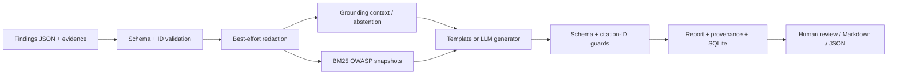

# DB Security Report Assistant

Trợ lý sinh báo cáo kiểm thử bảo mật CSDL và đề xuất remediation đối chiếu OWASP. Prototype nghiên cứu theo **ba RQ do người dùng cung cấp**, dùng cấu trúc 6 báo cáo của tài liệu FPT đính kèm; không lấy RQ từ tài liệu đó.

**Tải ZIP về máy cá nhân:** xem [hướng dẫn cài đặt và sử dụng](HUONG_DAN_SU_DUNG.md). Sau khi cài Python 3.12, Windows chạy `py -3.12 run.py --configure-gemini`, macOS/Linux chạy `python3.12 run.py --configure-gemini` trong thư mục đã giải nén để nhập key Gemini tại terminal và mở server. Launcher tự tạo môi trường và cài dependencies ở lần đầu. Xem [hướng dẫn Gemini và thu thập dữ liệu nghiên cứu](docs/GEMINI_RESEARCH_GUIDE.vi.md).

## Chạy ứng dụng

Python 3.12; không cần Node, Docker hay CSDL đích. Dùng checkout hiện có `/workspace/report_assistance`.

```bash
cd /workspace/report_assistance
python -m venv .venv
.venv/bin/python -m pip install -r requirements.lock.txt
.venv/bin/python -m uvicorn app.main:app --host 127.0.0.1 --port 8000
```

Ứng dụng có giao diện tiếng Việt ở route `/`; API schema tại `/docs`. Chọn tình huống mẫu → xem findings/bằng chứng → chọn chế độ → sinh báo cáo → kiểm tra trích dẫn → tải Markdown hoặc JSON. Có thể nhập JSON qua giao diện, theo định dạng `data/cases/*.json`.

Ứng dụng hỗ trợ **Gemini API gốc của Google** và template offline. Khi có cấu hình Gemini, chọn bộ sinh Gemini để nhận báo cáo do model tạo; không tự chuyển sang template khi API lỗi. Template không cần key và chỉ kiểm tra luồng phần mềm, không chứng minh khả năng AI hay trả lời các RQ bằng thực nghiệm. Cả hai luồng đều kiểm tra schema và tính hợp lệ ID trích dẫn trước khi lưu báo cáo.

### Cấu hình Gemini

Lấy key tại [Google AI Studio](https://aistudio.google.com/apikey), rồi cấu hình trên **máy cá nhân**:

```powershell
# Windows; nhập key vào lời nhắc ẩn của terminal, không viết key vào lệnh.
py -3.12 run.py --configure-gemini
```

macOS/Linux dùng `python3.12 run.py --configure-gemini`. Cấu hình được lưu ở `.local/settings.json`, đã được bỏ qua bởi Git và gói tải về. File này chứa key dạng văn bản trên máy local; không chia sẻ hoặc đồng bộ công khai. Launcher giới hạn quyền chủ sở hữu trên hệ thống hỗ trợ quyền Unix. Những lần sau chỉ cần `py -3.12 run.py` / `python3.12 run.py`.

Model gợi ý ban đầu là `gemini-flash-latest`, một alias có thể thay đổi. **Để nghiên cứu, chọn model ID cố định còn khả dụng trong tài khoản** và lưu `modelVersion` thực trả về; không mặc định một alias luôn trỏ cùng phiên bản. Cấu hình key chưa chứng minh quyền gọi API hoặc quota; lần gọi thật có thể báo lỗi quyền, model hoặc hạn mức.

Có thể dùng biến môi trường thay cho file cấu hình. Biến môi trường có ưu tiên cao hơn file local, kể cả giá trị rỗng:

| Biến | Ý nghĩa |
|---|---|
| `GEMINI_API_KEY` | API key Google Gemini; chỉ đặt ở server/terminal, không nhập vào hồ sơ JSON |
| `GEMINI_MODEL` | Model Gemini khả dụng, hỗ trợ đầu ra JSON có schema |
| `AI_PROVIDER` | `gemini` để chọn Gemini rõ ràng; `openai` cho chế độ tương thích cũ |
| `DB_REPORT_DATA_DIR` | Thư mục SQLite, mặc định `.local/` |

Gemini dùng HTTPS đến `generativelanguage.googleapis.com`; key nằm trong header `x-goog-api-key`, không nằm trong URL hoặc trình duyệt. Trong cloud, phải cấu hình hostname và secret destination qua environment settings. Không gửi API key trong chat. Phiên phát triển không có key thật để kiểm chứng thành công một lượt gọi Gemini; kiểm tra schema và các nhánh lỗi bằng mocks không thay thế lượt gọi thật.

Chế độ OpenAI-compatible cũ vẫn dùng `AI_PROVIDER=openai`, `AI_API_KEY`, `AI_MODEL` và `AI_BASE_URL` (mặc định `https://api.openai.com/v1`). Endpoint phải hỗ trợ JSON-mode Chat Completions. Không trộn hai provider trong cùng một nghiên cứu so sánh Grounding/RAG.

**Chỉ dùng evidence đã khử dữ liệu nhạy cảm.** Có redaction best-effort trước truy xuất/sinh/lưu, nhưng không bảo đảm loại bỏ PII hoặc mọi secret. Bật LLM nghĩa là ngữ cảnh findings và bằng chứng của chế độ Grounding sẽ gửi đến provider. SQLite giữ các báo cáo đã che dữ liệu ở máy local; xóa dữ liệu theo chính sách dự án. Prototype không có tài khoản, phân quyền, TLS đầu cuối hay chính sách đa người dùng: chỉ bind loopback cho nghiên cứu nội bộ.

## Pipeline và phạm vi



- PostgreSQL/MySQL là phạm vi thử nghiệm chính; các findings do người kiểm thử cung cấp. Hệ thống **không tự quét, không phát hiện lỗ hổng từ DB sống và không thực thi khắc phục**.
- Phân loại: SQL injection, quyền quá rộng, TLS, exposure, xác thực, audit, secrets, other. Severity giữ từ đầu vào, không tự tính CVSS.
- Mỗi claim có evidence ID và từng remediation có OWASP chunk ID khi chế độ tương ứng bật. Nguồn và nội dung bằng chứng, đoạn OWASP, revision, prompt/context/case hashes được giữ để truy xuất.
- ID hợp lệ không chứng minh bằng chứng hỗ trợ kết luận. Trạng thái `supported` và trường API `summary.confirmed` chỉ có nghĩa **có liên kết bằng chứng hợp lệ về cấu trúc**; không phải xác nhận lỗ hổng. Trường `semantic_validation` là `not_performed`.
- Thiếu evidence → yêu cầu kiểm tra thủ công. Fixture mâu thuẫn minh họa vì sao không được coi nhãn finding là ground truth.
- Prompt coi findings/evidence/OWASP là dữ liệu không đáng tin; chỉ dẫn trong tài liệu đính kèm không trở thành lệnh hệ thống. Đây là biện pháp giảm rủi ro, không bảo đảm chống prompt injection hoàn toàn.

## Ba câu hỏi nghiên cứu

| RQ | Câu hỏi (giữ nội dung người dùng) | Đo lường cần thực nghiệm |
|---|---|---|
| RQ1 — Security Report Generation | Trợ lý AI có thể phân tích các security findings và tự động sinh báo cáo kiểm thử bảo mật cơ sở dữ liệu với mức độ chính xác, đầy đủ và khả năng truy xuất bằng chứng như thế nào? | Expert factual accuracy, gold-claim completeness, evidence entailment, traceability |
| RQ2 — OWASP-Based Remediation Recommendation | Trợ lý AI có thể đề xuất các biện pháp khắc phục lỗ hổng bảo mật cơ sở dữ liệu phù hợp với security findings, bằng chứng thu thập được và hướng dẫn OWASP đến mức nào? | Relevance, applicability, actionability, OWASP alignment, lab verification |
| RQ3 — Evidence Grounding & OWASP RAG Effectiveness | Việc tích hợp Evidence Grounding và OWASP RAG ảnh hưởng như thế nào đến độ chính xác phân tích security findings và chất lượng khuyến nghị remediation của trợ lý AI? | Paired 2×2 ablation, cluster-level effects / interaction / confidence intervals |

### Chạy bốn điều kiện

**Qua web:** nhập/chọn một case, mở **Thiết kế nghiên cứu**, chọn số lần lặp, kiểm tra số lượt gọi và nhấn nút chạy thực nghiệm Gemini. Một case × 4 cấu hình × 3 lần lặp = **12 lượt gọi API**, có thể tính phí hoặc gặp quota. Chờ kết thúc rồi tải ZIP kết quả: báo cáo, `manifest.json`, `runs.jsonl` và `expert-review.csv` để chuyên gia chấm. Chạy một case trên web phù hợp cho pilot; một study cần nhiều case được phân cụm và chia tập theo protocol. Hướng dẫn chi tiết: [Gemini và dữ liệu nghiên cứu](docs/GEMINI_RESEARCH_GUIDE.vi.md).

**Qua CLI:** sau khi cấu hình Gemini bằng launcher, có thể chạy toàn bộ thư mục case. Không chạy đồng thời nhiều batch nếu quota thấp.

```bash
.venv/bin/python scripts/run_experiment.py --provider template --output outputs/smoke-001
# Khi đã có provider và dataset holdout được chuyên gia duyệt:
.venv/bin/python scripts/run_experiment.py --provider llm --cases /path/to/heldout --repeats 3 --output outputs/llm-001
```

G0R0: finding metadata; G1R0: thêm evidence và ràng buộc grounding; G0R1: thêm OWASP; G1R1: cả hai. G0 không nhận evidence content/IDs. R0 không nhận OWASP chunks. Retrieval query chỉ phụ thuộc metadata để giữ cố định giữa hai mức G. Hiệu ứng G gồm **quyền truy cập bằng chứng + hướng dẫn grounding**; hiệu ứng R gồm **ngữ cảnh OWASP + hướng dẫn trích dẫn**, không được diễn giải thành hiệu ứng của riêng một câu prompt.

Runner xáo trộn thứ tự có seed, ghi JSONL runs, hashes, thời gian, trạng thái lỗi, báo cáo và CSV rubric trống. Không tự điền điểm chuyên gia. Failed runs giữ riêng và trả exit code khác 0; không lặng lẽ loại bỏ. Template chạy một lần đủ kiểm tra phần mềm; nghiên cứu LLM cần giữ model/config cố định và nhiều lần lặp. `blind_id` chỉ là mã phân phối; bản JSON vẫn lộ chế độ, cần biên tập bản dành cho reviewer theo protocol trước khi đánh giá.

API `/api/evaluate` chỉ tính diagnostics về cấu trúc: finding coverage, tỷ lệ claim có citation và citation-ID validity; không dùng làm accuracy, entailment hoặc chất lượng remediation. Không có mẫu số trả `null`. `unsupported_claim_rate` luôn `null` cho tới khi có nhãn đánh giá bên ngoài. Ba case tổng hợp đi kèm là fixture kiểm thử, **không phải dataset hoặc ground truth nghiên cứu**.

## Kiểm chứng

```bash
.venv/bin/python -m unittest discover -s tests -v
curl --fail http://127.0.0.1:8000/api/health
```

Các test không cần mạng và không phát sinh chi phí model. Chúng kiểm tra validation, redaction, checksum nguồn, truy xuất, bốn chế độ, abstention, export/persistence và guard phản hồi LLM giả lập. Xem [VALIDATION.md](VALIDATION.md) để biết kết quả thực chạy, giới hạn và những phần chưa đánh giá.

## Hồ sơ nghiên cứu

- [Đề cương và 6 chương](docs/research-proposal.md), [bản Word](docs/research-proposal.docx).
- [Thiết kế đánh giá và rubric](docs/evaluation-protocol.md).
- [Kế hoạch tổng quan tài liệu](docs/literature-review.md).

Theo file hướng dẫn: tài liệu học thuật bằng tiếng Anh; abstract 200–300 từ, 3–10 keywords, trích dẫn IEEE theo thứ tự; báo cáo 1–6 có trọng số 10/25/20/25/15/5%. Chương Results/Discussion/Conclusion là **mẫu chờ dữ liệu**, không có kết quả nghiên cứu bịa đặt.

## Nguồn OWASP và giấy phép

Knowledge base gồm bốn Cheat Sheets chính thức (Database Security, SQL Injection Prevention, Logging, Secrets Management) lưu trong `data/owasp/`, pin commit và SHA-256 trong `manifest.json`. Khi mở app, checksum sai làm khởi động thất bại. Truy xuất BM25 lexical offline, không phải semantic embeddings; chất lượng truy xuất phải đánh giá riêng. Không mặc định rằng nội dung snapshot là bản mới nhất hiện tại.

OWASP Cheat Sheet Series contributors, **CC BY-SA 4.0**. Giữ nguyên [giấy phép](data/owasp/LICENSE.md), attribution và URL snapshot; nội dung OWASP được tách khỏi mã dự án. Báo cáo xuất có đoạn OWASP trích lại: tuân thủ attribution/share-alike áp dụng cho phần tái sử dụng hoặc phái sinh theo giấy phép. Đây là ứng dụng tham khảo hướng dẫn OWASP, không phải chứng nhận tuân thủ.
